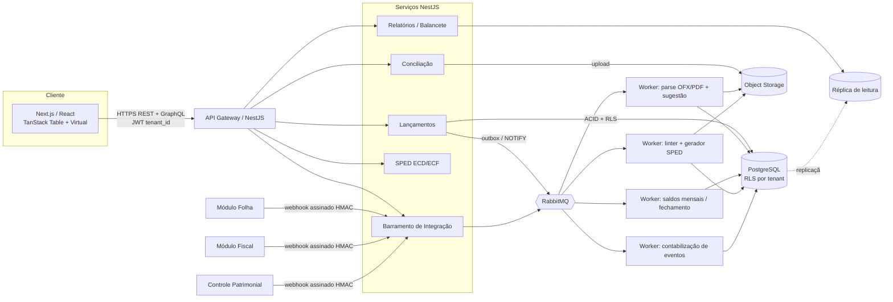
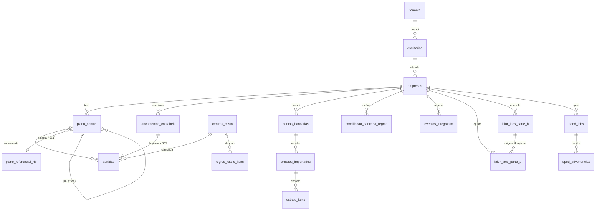
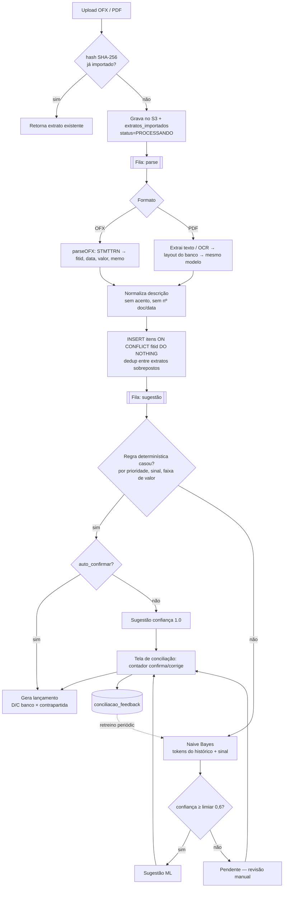
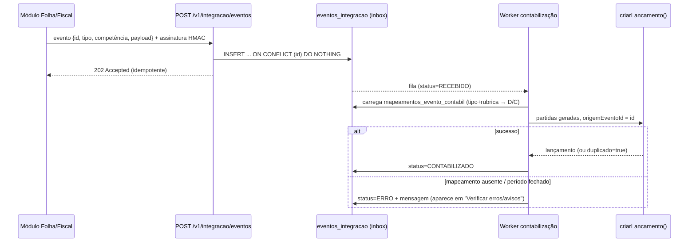
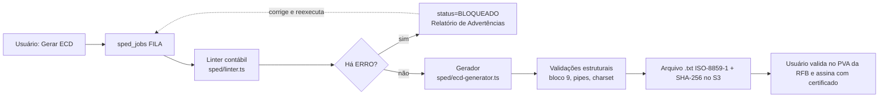

# Sistema Gênesis ERP — Especificação Técnica

> Referência funcional: Módulo Contábil do Calima ERP (cópia da página + tela do *Balancete dinâmico* na pasta `F:\RH`).
> Esta especificação é acompanhada de código **executado e testado**: `db/01_schema.sql` (aplicado em PostgreSQL 16), `src/*` (5 testes passando) e `src/relatorios/balancete.sql` (rodado contra dados reais de teste).

## Sumário
> **Módulo SST** (PGR, EPI, psicossociais, PCMSO/ASO, LTCAT/PPP/FAP, eSocial, financeiro, GED): ver `ESPECIFICACAO_SST.md`. **Agente de IA** e cofre da chave OpenAI: `ESPECIFICACAO_IA.md`.

1. Arquitetura e stack
2. Modelagem de dados
3. Motor de regras e endpoints
4. Módulo SPED (ECD/ECF) e pré-validação
5. Mapa de funcionalidades (Calima → este sistema)
6. Roadmap, riscos e itens que exigem validação com o contador responsável

---

## 1. Arquitetura e stack

### 1.1 Decisões

| Tema | Decisão | Por quê |
|---|---|---|
| Multi-tenancy | **1 banco + RLS** (`tenant_id` em toda tabela, `FORCE ROW LEVEL SECURITY`, `SET LOCAL app.tenant_id` por transação) | Milhares de CNPJs: schema-per-tenant explode catálogo/migrações (10k schemas × centenas de tabelas). RLS mantém 1 migração, pool de conexões único e isolamento garantido **pelo banco**, mesmo com bug na API. |
| Escala dos tenants grandes | Particionar `partidas` por `HASH(empresa_id)` (ou RANGE por ano) ao passar de ~200 M linhas; *tenant* gigante pode migrar para banco dedicado (mesmo schema) | Evolução sem reescrever a aplicação |
| Backend | **NestJS (TypeScript)** + workers Node; módulos de alto custo (parser PDF/OCR) podem virar serviços Go depois | Mesmo tipo/validadores no front e no back; o time já escreve TS. Go/Kotlin são alternativas válidas — a arquitetura não depende da escolha. |
| Orientação a eventos | **Outbox transacional + RabbitMQ** (filas de trabalho) | Conciliação/fechamento/SPED são *jobs* com retry e DLQ — padrão de fila, não de log. Kafka só se houver necessidade de replay/analytics de grande volume. |
| Frontend | Next.js + React + Tailwind + **TanStack Table + TanStack Virtual** | Balancete/razão de 100k+ linhas: renderiza só as linhas visíveis (~30 nós DOM) |
| Dinheiro | `numeric(18,2)` no banco; **string decimal + BigInt (centavos)** na aplicação; nunca `float` | `0.1+0.2` precisa fechar exato (há teste para isso) |
| Armazenamento de arquivos | S3-compatível (extratos, SPED gerado), hash SHA-256 | Idempotência e trilha de auditoria |
| Observabilidade/Segurança | OpenTelemetry, auditoria de alteração de lançamentos, criptografia em repouso, LGPD (papéis, log de acesso) | Dados fiscais/financeiros |

### 1.2 Diagrama de componentes



### 1.3 Isolamento de tenant (como é imposto)

1. Cada requisição carrega JWT com `tenant_id`.
2. A primeira instrução da transação é `SELECT set_config('app.tenant_id', $1, true)` (escopo da transação — não vaza entre conexões do pool).
3. A role da aplicação **não** tem `BYPASSRLS`; as políticas `USING/WITH CHECK (tenant_id = app_tenant())` valem em todas as tabelas com `tenant_id`.
4. **Testado**: sem `app.tenant_id` → 0 linhas; tenant errado → 0 linhas; tenant correto → vê só os seus.

---

## 2. Modelagem de dados

DDL completo em **`db/01_schema.sql`**. Visão conceitual:



### 2.1 Decisões de modelagem que merecem destaque

* **Partida = uma perna (`dc` D/C), não uma linha com `debito_conta_id` + `credito_conta_id`.**
  A especificação pedia as duas colunas na linha; isso só representa 1:1. Com N pernas, os formatos 1:N, N:1 e N:N viram o mesmo modelo e mapeiam diretamente para os registros **I200 (cabeçalho) / I250 (partida)** da ECD. A visão "débito/crédito lado a lado" do razão é obtida por query (ver `balancete.sql`).
* **Plano de contas em `ltree`.** O código contábil `1.1.1.01.0001` já é um `ltree` válido; `caminho <@ conta.caminho` soma a subárvore inteira sem CTE recursiva — é isso que torna o balancete de milhares de contas uma única passada.
* **Três barreiras para ΣD = ΣC**: validação na API (mensagem amigável) → transação ACID → `CONSTRAINT TRIGGER … DEFERRABLE INITIALLY DEFERRED` no banco, que verifica no COMMIT (permite inserir as pernas uma a uma). **Testado**: D=100,00 × C=99,99 → `ERROR: Lançamento … desbalanceado`.
* **Regras no banco**: conta sintética/inativa não recebe partida; período `FECHADO/ENCERRADO` é imutável.
* **Idempotência**: `UNIQUE (empresa_id, origem_evento_id)` em lançamentos, `UNIQUE (conta_bancaria_id, fitid)` em itens de extrato e `hash_arquivo` em extratos — reenvio de webhook ou reimportação de OFX nunca duplica.
* **Plano referencial** (`plano_referencial_rfb`) é tabela global versionada por vigência; `empresas.plano_referencial_tipo` escolhe qual aplicar (Lucro Real, Presumido, Imune/Isenta…).
* **LALUR/LACS**: Parte A = ajustes do período (adição, exclusão, compensação); Parte B = contas de controle com `saldo_final` calculado (`inicial + constituído − baixado`), e `CHECK >= 0` impede compensar mais do que o saldo.
* **Saldos**: `saldos_mensais` (mantida por worker a partir do evento `lancamento_gravado`) acelera balancetes de períodos longos; a query do balancete funciona sem ela (útil para validar a tabela).

---

## 3. Motor de regras, funcionalidades e endpoints

### 3.1 Lançamentos múltiplos — `src/lancamentos/`

**Contrato (REST):**

```http
POST /v1/empresas/{empresaId}/lancamentos
Idempotency-Key: <uuid>            # vira origem_evento_id quando vier de integração
{
  "data": "2025-01-10",
  "documento": "NF 1234",
  "partidas": [
    { "contaId": "…caixa…",   "dc": "D", "valor": "100.00" },
    { "contaId": "…fornec…",  "dc": "C", "valor": "60.00"  },
    { "contaId": "…fornec…",  "dc": "C", "valor": "40.00", "centroCustoId": "…", "historico": "parcela 2" }
  ]
}
→ 201 { "id": "…", "numero": 1042, "formato": "1:N" }
→ 422 { "codigo": "LANCAMENTO_INVALIDO", "detalhes": ["Lançamento desbalanceado: débitos=100.00 créditos=99.99 (diferença 0.01)."] }
```

Outros endpoints: `PUT /lancamentos/{id}` (substitui as partidas na mesma transação), `DELETE /lancamentos/{id}`, `POST /lancamentos/lote` (importação planilha/CSV, processada por job), `PATCH /lancamentos/lote` (alteração em massa), `GET /lancamentos?conta=&de=&ate=&documento=`, `POST /lancamentos-padrao/{id}/aplicar`.

**Implementação:** `validar.ts` (puro; soma em centavos/BigInt; classifica 1:1, 1:N, N:1, N:N) e `lancamento.service.ts` (transação única: tenant → idempotência → validação → cabeçalho → *multi-row insert* de partidas → `pg_notify`). Em N:N o sistema **não** tenta "casar" débito com crédito: só exige o total; a contrapartida exibida no razão vira "VÁRIAS".

### 3.2 Ingestão e conciliação bancária — `src/conciliacao/`



* **Parser OFX** (`ofx-parser.ts`): aceita OFX 1.x (SGML sem tags de fechamento) e 2.x (XML); data `20250131120000[-3:BRT]` → `2025-01-31`; valor `-1.234,56` → `-1234.56` sem float.
* **Motor** (`motor-regras.ts`): *estágio 1* regras do contador (`CONTEM | COMECA_COM | IGUAL | REGEX`, prioridade, sinal entrada/saída, faixa de valor); regex do usuário é protegida contra ReDoS. *Estágio 2* Naive Bayes multinomial (suavização de Laplace), por empresa, treinado com `conciliacao_feedback`. **ML nunca confirma sozinho** — só regras marcadas `auto_confirmar` geram lançamento sem revisão; é uma decisão de risco contábil, não de acurácia.
* **PDF**: texto digital → extração por layout do banco; escaneado → OCR. É a parte de maior variabilidade; o modelo prevê *perfis de layout por banco* e fila de revisão para falhas de parse.
* Geração do lançamento: entrada (`valor>0`) = D banco / C contrapartida; saída = D contrapartida / C banco.

### 3.3 Barramento de integração (Folha, Fiscal, Patrimônio)



Tipos de evento: `FOLHA.PROVISAO_FERIAS`, `FOLHA.PROVISAO_13`, `FOLHA.RESCISAO`, `FOLHA.GPS`, `FOLHA.DARF_IRRF`, `FOLHA.FGTS`, `FISCAL.NF_ENTRADA`, `FISCAL.NF_SAIDA`, `FISCAL.RETENCAO`, `PATRIMONIO.DEPRECIACAO`. O payload traz **rubricas** (`inss_empresa`, `irrf`, …); o contador mapeia cada rubrica a débito/crédito uma vez (`mapeamentos_evento_contabil`) e, desse ponto em diante, a contabilização é automática. Evento sem mapeamento não é perdido: fica em `ERRO` e é reprocessável após o contador configurar o de-para.

### 3.4 Relatórios e balancete interativo

* **Balancete** — `GET /v1/empresas/{id}/balancete?de=2025-01&ate=2025-01&somenteMovimento=false`. Query única em `src/relatorios/balancete.sql`: agrega `partidas` por conta analítica e soma a subárvore por `ltree`. Saldo de contas de **resultado não herda exercícios anteriores** (reinicia em `data_ini_exercicio`) — verificado: receita lançada em dez/2024 não aparece no balancete de jan/2025.
* **Drill-down** (espelha a tela do Calima): cada linha traz `permite_razao` (só analíticas). Clique abre modal `GET /v1/empresas/{id}/razao?conta=&de=&ate=` com **saldo acumulado por window function** e `lancamento_id` por linha; clicar numa linha abre o formulário do lançamento original (`PUT /lancamentos/{id}`), e ao salvar o balancete refaz só a consulta. Ícones "visualizar saldos" e "gráfico" consomem `saldos_mensais`.
* **Balanço e DRE**: mesma fonte; Balanço = contas `cod_natureza` 01/02/03 por saldo na data-base (+ resultado do período no PL quando não encerrado); DRE = natureza 04 acumulada no período, agrupada pelas sintéticas de nível configurado. DMPL, DLPA, Fluxo de Caixa (direto/indireto), Livro Caixa e Análise Financeira entram como relatórios sobre o mesmo conjunto de saldos.
* **Frontend 100k+ linhas**: a API devolve o balancete **achatado e ordenado** (`ORDER BY caminho`) e o cliente expande/recolhe localmente (estado de expansão em `Set`); `TanStack Virtual` renderiza só a janela visível. Razão usa paginação por cursor `(data, numero, id)`.

---

## 4. Módulo SPED (ECD e ECF)

### 4.1 Pipeline



### 4.2 Gerador (`ecd-generator.ts`)

Texto posicional-delimitado: uma linha por registro, `|` inicial e final, **ISO-8859-1**, **CRLF**, decimal com vírgula, datas `DDMMAAAA`, campos higienizados (`|` e quebras removidos). Estrutura implementada:

| Bloco | Registros | Fonte |
|---|---|---|
| 0 | `0000` (abertura), `0001`, `0990` | `empresas` |
| I | `I001`, `I010`, `I030` (termo), `I050` (plano), `I051` (referencial), `I150`/`I155` (saldos por mês e conta), `I200`/`I250` (lançamentos/partidas), `I990` | `plano_contas`, `saldos_mensais`, `lancamentos_contabeis`, `partidas` |
| J | `J001`, `J005/J100/J150` (Balanço, DRE), `J800`, `J990` | relatórios (stub no exemplo) |
| 9 | `9001`, `9900` (um por tipo, **contagem exata**, inclusive do próprio 9900), `9990`, `9999` | calculado |

O teste valida que cada `9900` declara a contagem real e que `9999` = total de linhas (erro que apareceu durante o desenvolvimento e foi corrigido). Para a **ECF** o mesmo gerador-base é reutilizado: Bloco 0 (parâmetros de tributação), **K** (saldos), **L/P/N/T** (apuração por regime) e **M** (e-Lalur/e-Lacs — alimentado por `lalur_lacs_parte_a/b`).

### 4.3 Linter contábil (`linter.ts`)

| Regra | Severidade | Detecta |
|---|---|---|
| `SALDO_INVERTIDO` | AVISO | Conta de natureza D com saldo C (ou vice-versa), exceto redutoras (`redutora=true`) e contas de resultado |
| `SEM_REFERENCIAL` / `REFERENCIAL_INEXISTENTE` / `REFERENCIAL_SINTETICO` / `REFERENCIAL_NATUREZA` | ERRO/AVISO | Analítica sem amarração RFB; amarração a código inexistente na vigência, sintético ou de natureza divergente |
| `LCTO_CONTA_INEXISTENTE` / `_SINTETICA` / `_INATIVA` / `LCTO_SEM_REFERENCIAL` | ERRO/AVISO | Lançamentos órfãos ou sem amarração |
| `LCTO_DESBALANCEADO` | ERRO | ΣD ≠ ΣC (carga externa que contornou a API) |
| `BALANCETE_X_DRE` | ERRO | Resultado apurado pelas contas 04 ≠ resultado da DRE |
| `EQUACAO_PATRIMONIAL` | ERRO | Ativo ≠ Passivo + PL + Resultado |

Erros **bloqueiam a geração** (o PVA rejeitaria); avisos vão ao "Relatório de Advertências", equivalente ao do Calima. Todas as comparações em centavos/BigInt.

---

## 5. Mapa de funcionalidades (Calima → este sistema)

| Funcionalidade (página do Calima) | Onde está nesta especificação |
|---|---|
| Lançamento normal, simplificado, em massa (1:N, N:N), importação CSV/planilha, lançamentos padrão | §3.1; `historicos_padrao`, endpoints `/lote` |
| Conciliação bancária OFX/PDF, vínculo histórico→conta | §3.2; `conciliacao_bancaria_regras` |
| Contabilização automática Folha/Fiscal/Patrimônio | §3.3; `eventos_integracao`, `mapeamentos_evento_contabil` |
| SPED ECD/ECF + Relatório de Advertências | §4 |
| Balanço, DRE, DMPL, DLPA, Livro Caixa, Razão, Fluxo de Caixa, Análise Financeira | §3.4 |
| Balancete dinâmico, lançamento pelo modal do razão, gráficos | §3.4 (query + drill-down) |
| Plano referencial da Receita pré-cadastrado | `plano_referencial_rfb` (carga versionada) |
| Lalur/Lacs | `lalur_lacs_parte_a/b` |
| Centro de custos e relatórios | `centros_custo`, `regras_rateio` |
| Verificar erros/avisos | linter + `eventos_integracao.status=ERRO` |
| Encerrar contas de resultado; transferência de lançamentos entre contas | job de encerramento gera lançamentos `tipo_lcto='E'`; transferência = `UPDATE partidas SET conta_id` em lote, auditada |
| Fechamento/Restauração de período | `periodos_contabeis.status` + trigger |

## 6. Roadmap, riscos e pontos a validar

**Fases sugeridas:** (1) núcleo — plano de contas, lançamentos, razão, balancete; (2) conciliação OFX + regras; (3) integrações Folha/Fiscal; (4) Balanço/DRE/demais demonstrações; (5) ECD + linter; (6) LALUR + ECF; (7) ML e OCR de PDF.

**O que NÃO está pronto / precisa de validação antes de produção**
1. **Leiautes SPED**: os campos dos registros ECD seguem o leiaute conhecido, mas a RFB o altera a cada ano. Versione por ano-calendário e **valide cada arquivo no PVA oficial** — não foi feito aqui (o PVA não é acessível neste ambiente). Blocos J (demonstrações) e toda a **ECF** estão especificados, não implementados.
2. **Regras tributárias do LALUR** (limite de 30% na compensação de prejuízos, tabelas de lançamentos da Parte A, tratamento por regime) devem ser definidas e revisadas por contador responsável; o schema comporta, mas o cálculo de apuração é um módulo à parte.
3. **Campo `redutora`** e `cod_natureza` dependem de plano de contas bem configurado; o linter é tão bom quanto o cadastro.
4. **Backend NestJS**: foram entregues os módulos críticos como funções/serviços independentes de framework (injeção de `Db`/`Tx`); controllers, autenticação, filas e telas não foram construídos.
5. Parser de **PDF** depende dos layouts reais dos bancos do cliente.
6. Testes de carga (100k+ linhas no front; balancete com milhões de partidas) ainda por fazer — a estratégia (índice *covering*, `ltree`, `saldos_mensais`, réplica de leitura) está desenhada, não medida.

## Como rodar o que já existe

```bash
# Banco (PostgreSQL 15+)
createdb erp && psql -d erp -f db/01_schema.sql   # + db/02_sst.sql e db/03_sst_gestao.sql (módulo SST)
# Testes dos módulos (Node 22+)
node --experimental-strip-types --test test/smoke.test.ts test/sst.test.ts test/agente.test.ts
```
