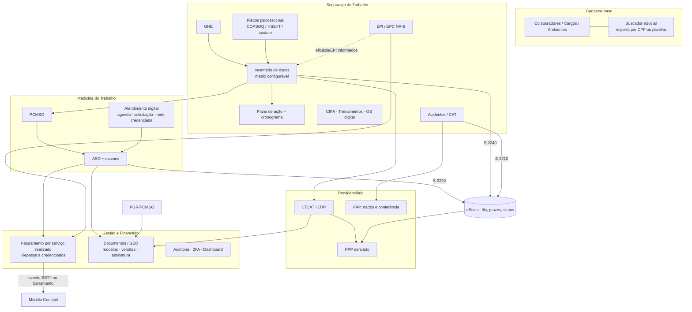
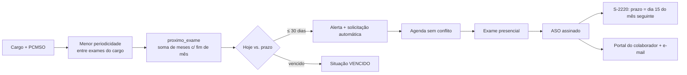

# Módulo SST — Saúde e Segurança do Trabalho

> Complemento de `ESPECIFICACAO.md`. Referência funcional: as páginas públicas do SGG (sgg.net.br) listadas no pedido.
> Usado só como mapa de funcionalidades; o desenho e o código são próprios.
> Entregue com `db/02_sst.sql` e `db/03_sst_gestao.sql` (aplicados em PostgreSQL 16 junto com o `01`: **72 tabelas, todas com `tenant_id` sob RLS**) e `src/sst/*` (6 módulos, 6 testes).

## 1. Visão geral



**Ideia central:** o PGR/GRO é a fonte da verdade. Daí derivam o PCMSO (exames por risco), o LTCAT (exposição), o S-2240 (condições ambientais) e o PPP. Ninguém redigita: mudou o inventário → o sistema aponta o que precisa ser reemitido.

## 2. Mapa de funcionalidades (páginas SGG → onde está aqui)

| Página | Funcionalidade | Implementação |
|---|---|---|
| **PGR** | Inventário de riscos, matriz configurável (inclusive multidimensional), plano de ação, PGRTR, PAE | `pgr_documentos`, `inventario_riscos`, `matrizes_risco`, `plano_acao`; `src/sst/matriz-risco.ts` |
| PGR | Avaliação por GHE, qualitativa e quantitativa; cronograma com alertas | `ghe`, `ghe_cargos`; `plano_acao.prazo` + índice de vencimento |
| **Gestão de EPI** | Ficha digital, assinatura biométrica, CA e validade, estoque/mínimo, lote e NF, QR, EPC | `epi_*`, `epc_*`; `src/sst/epi.ts` |
| **Riscos psicossociais** | COPSOQ II / HSE-IT / personalizado, envio multicanal, classificação baixo→crítico, plano de ação ligado ao PGR | `psicossocial_*`; `src/sst/psicossocial.ts` |
| **LTIP / LTCAT** | Laudos com modelo, fluxo liberar/recusar, código de autenticidade, painel de vencimento, anexo externo, A1 | `ltcat_documentos`, `doc_modelos`; `modelos-documento.ts` |
| **PCMSO** | Exames e periodicidade por cargo ligados aos riscos do PGR, versionamento, relatório analítico | `pcmso_programas`, `pcmso_exames_cargo` |
| **ASO** | Todos os tipos, PDF em lote, histórico/auditoria, assinatura ICP-Brasil/biométrica, S-2220 automático | `asos`, `aso_exames`; `src/sst/aso.ts` |
| **Atendimento digital** | Agenda online sem conflito, confirmação, audiometria integrada, vencimentos | `solicitacoes_exame`, `agenda_slots` (exclusão por intervalo) |
| **PPP** | Gerado a partir de S-2240 + S-2220 + vínculo; reemissão por mudança de função/risco; PDF assinado | `ppp_emissoes` (histórico); dados vêm das tabelas-fonte, não duplicados |
| **FAP** | Importa índices do FAPWeb, cruza com PGR/PCMSO/CAT, confere benefícios do CNPJ | `fap_indices_importados`, `fap_beneficios_cnpj`, `fap_simulacoes` |
| **Gestão** | Raio-X (dashboard), usuários, 2FA, agenda, log de operações | `auditoria_log` (append-only); 2FA na camada de autenticação |
| **Financeiro** | Preço por cliente/convênio/credenciado, faturamento por serviço realizado, NFS-e/boleto/PIX, conciliação, fluxo de caixa | `tabela_precos`, `faturas_sst(_itens)`; reaproveita a conciliação bancária do módulo contábil |
| **Documentos** | GED com versões, trilha, assinatura, portal do cliente | `doc_arquivos`, `doc_acessos` |
| **eSocial / Buscador** | S-2210, S-2220, S-2221, S-2240; status, reenvio, protocolo; busca por CPF | `esocial_eventos`; `esocial-prazos.ts` |
| **SGGNet** | Rede credenciada, solicitações, repasse | `credenciados`, `repasses_credenciado` |
| **SGG APP** | Portal do colaborador e do gestor | API de leitura; ver §6 |
| **IA** | Análise de exames, risco por foto, resumo clínico, relatório PCMSO, assistente | `ia_uso`; regra: IA gera **rascunho** |
| CIPA, treinamentos, OS, CAT (citados na página de segurança) | Mandatos/eleição, presença e certificados, investigação de acidente | `cipa_*`, `treinamentos*`, `acidentes_trabalho` |

## 3. Decisões de projeto

**3.1 Matriz de risco sem `eval`.** O cálculo "configurável" é declarativo: `PRODUTO`, `SOMA` ou `TABELA` (lookup de todas as combinações), com 2+ dimensões e faixas/cores editáveis. Configuração salva por usuário nunca vira código executável. A validação exige faixas crescentes e tabela completa. Teste: 5×5 padrão, matriz 3 dimensões e config inválida.

**3.2 EPI: prova e estoque no mesmo ato.** A entrega congela o CA vigente (`ca_no_ato`), baixa por **FEFO** (vence primeiro, sai primeiro), ignora lote vencido e **bloqueia CA vencido**. O serviço deve rodar com `SELECT … FOR UPDATE` nos lotes. Guarda-se a **evidência e o hash**, não o template biométrico bruto (dado sensível, LGPD art. 11).

**3.3 Anonimato psicossocial por desenho (não só por política).**
* `psicossocial_convites` sabe *quem* respondeu, mas não *o quê*; `psicossocial_respostas` guarda o *quê* (por grupo), mas não *quem*, e só a data, sem timestamp que permita correlação.
* A tabela de respostas só é legível pela role `WORKER_PSICOSSOCIAL` (política `RESTRICTIVE`). **Testado:** como `MEDICO` → 0 linhas; como worker → 1.
* Grupos com menos de **k** respondentes (padrão 5, mínimo 3) têm a média **suprimida**. Testado: grupo de 3 não exibe nada.
* Itens invertidos e dimensões "positivas" (ex.: apoio social) são normalizados em 0–100 e classificados em baixo/moderado/alto/crítico; as **faixas são parâmetros do instrumento**, não constantes do código.

**3.4 Dado de saúde protegido em duas camadas.** `asos` e `acidentes_trabalho` têm, além do tenant, política restritiva por papel (`MEDICO/SST/RH/ADMIN`). **Testado:** sem papel ou como `CLIENTE_LEITURA` → 0 linhas; como `MEDICO` → vê. Acesso a documentos grava `doc_acessos`; operações sensíveis gravam `auditoria_log`, **append-only** (UPDATE/DELETE viram no-op; testado).

**3.5 Atendimento sem overbooking.** `agenda_slots` usa `EXCLUDE USING gist (profissional, tstzrange)`: o banco recusa sobreposição, mesmo com duas requisições simultâneas. Testado: 09:15–09:45 rejeitado sobre 09:00–09:30; 09:30–10:00 (adjacente) aceito.

**3.6 Faturar só o que foi realizado, uma vez.** `faturas_sst_itens` aponta a origem (aso, solicitação, documento) com `UNIQUE (origem_tabela, origem_id)`: o mesmo serviço nunca é cobrado duas vezes. O repasse ao credenciado calcula `divergencia` = valor faturado pelo credenciado − valor apurado pelo sistema.

**3.7 PPP é derivado.** Não há tabela de "dados do PPP": ele é montado a partir do vínculo, do S-2240 e do S-2220. Só o histórico de emissões é guardado.

**3.8 FAP: o sistema apoia, não substitui.** O índice oficial e a contestação são do FAPWeb (fora do sistema). O que entra: importar os índices, cruzar CATs/benefícios do CNPJ e apontar inconsistências antes da contestação. Simulação do FAP é marcada como evolução futura (a própria referência a trata assim).

**3.9 Integração com a contabilidade.** O barramento ganhou o módulo `SST` (`ALTER` em `eventos_integracao`). Eventos publicados: `SST.EPI_CONSUMO` (D despesa de EPI / C estoque), `SST.EXAMES_OCUPACIONAIS` (D despesa / C fornecedores) e `SST.FATURAMENTO` (D clientes / C receita de serviços). O contador só mapeia as rubricas uma vez (`mapeamentos_evento_contabil`).

## 4. Fluxos críticos

### 4.1 Do risco ao documento e ao eSocial

```mermaid
sequenceDiagram
  participant T as Técnico SST
  participant I as Inventário (PGR)
  participant M as Matriz
  participant P as PCMSO
  participant L as LTCAT
  participant E as eSocial (fila)
  T->>I: avalia agente no GHE (ex.: ruído 87 dB(A))
  I->>M: severidade × probabilidade
  M-->>I: nível + cor
  I->>P: exige exames do cargo (audiometria, periodicidade)
  I->>L: reaproveita exposição (sem redigitar)
  L->>L: responsável técnico libera ou recusa
  I->>E: cria S-2240 (PENDENTE) com prazo calculado
  E->>E: valida → assina (A1/A3) → envia → protocolo/recibo
  alt rejeitado
    E-->>T: erro; volta a PENDENTE p/ correção e reenvio
  end
```

### 4.2 ASO ao S-2220, com vencimentos



### 4.3 Acidente e CAT
Registro do acidente → `S-2210` com prazo: **próximo dia útil** (considera feriados cadastrados) ou **imediato em caso de óbito** → investigação gera `plano_acao` (origem `ACIDENTE`) → CAT alimenta o cruzamento do FAP.

## 5. Endpoints (REST, prefixo `/v1/empresas/{id}`)

| Recurso | Operações principais |
|---|---|
| `/ghe`, `/inventario-riscos` | CRUD; `POST /inventario-riscos/{id}/avaliar` (aplica matriz); `GET /inventario-riscos?ghe=` |
| `/matrizes-risco` | CRUD com `POST /validar` e `POST /simular {valores}` |
| `/plano-acao` | CRUD; `PATCH …/concluir` (exige evidência); `GET ?status=&vencendoEm=` |
| `/epi/entregas` | `POST` (valida CA, FEFO, assinatura); `POST …/{id}/devolucao`; `GET /epi/alertas` |
| `/psicossocial/campanhas` | CRUD; `POST …/convites` (gera links; guarda só o hash); `POST /respostas` (público, por token); `POST …/apurar` (worker) |
| `/pcmso`, `/asos` | CRUD; `POST /asos/lote`; `GET /asos/vencimentos?dias=30` |
| `/solicitacoes-exame`, `/agenda` | solicitar (individual/lote), reservar slot, confirmar, cancelar |
| `/ltcat`, `/ppp` | `POST /ltcat/{id}/liberar` ou `/recusar`; `GET /ltcat/validar/{codigo}` (público); `POST /ppp/emitir` |
| `/esocial/eventos` | `GET ?status=&atrasados=true`; `POST …/{id}/validar|assinar|enviar|reenviar` |
| `/financeiro/faturas`, `/repasses` | `POST /faturas/gerar?competencia=` (só serviços realizados); conferência de repasse |
| `/documentos` | upload, nova versão, `POST …/assinar`, `POST …/compartilhar` |
| `/ia/{funcao}` | rascunho + consumo de tokens; exige revisão humana para virar documento |

## 6. Portais (app)
* **Colaborador:** ASO, PPP, certificados, fichas de EPI (assina por biometria facial), treinamentos pendentes.
* **Gestor/cliente:** documentos por categoria/empresa/setor, treinamentos exigidos, mensageria com a prestadora.
* Acesso só a documentos marcados `compartilhado_portal`; toda abertura grava `doc_acessos`.

## 7. Prazos eSocial (`esocial-prazos.ts`)

| Evento | Prazo implementado | Status |
|---|---|---|
| S-2210 CAT | Próximo dia útil; óbito: imediato | Consistente com a página consultada |
| S-2220 ASO | Dia 15 do mês seguinte ao exame | Consistente |
| S-2221 toxicológico | Estrutura de evento prevista; regra de prazo **não implementada** | Pendente |
| S-2240 | **Sem padrão.** Exige escolher `DIA15_MES_SEGUINTE` ou `ANTES_INICIO_EXPOSICAO` | **Fontes divergem** |

Máquina de estados: `PENDENTE → VALIDADO → ASSINADO → ENVIADO → PROCESSADO | ADVERTENCIA | REJEITADO`; rejeitado volta a `PENDENTE`; processado/advertência podem virar `RETIFICADO`. Saltos inválidos (ex.: `PENDENTE → ENVIADO`) são recusados.

## 8. O que NÃO está pronto e precisa de validação

1. **XML dos eventos eSocial**: o schema, a fila, os prazos e os estados estão prontos, mas **a geração do XML segue o leiaute oficial (XSD) vigente e deve ser validada contra ele e no ambiente de produção restrita**. Não implementei por não ter o XSD aqui.
2. **S-2240: prazo.** A referência apresenta duas regras diferentes (corpo × FAQ). Confirme no Manual de Orientação do eSocial antes de escolher.
3. **S-1060** (tabela de ambientes): não aparece nas páginas consultadas. `ambientes_trabalho` o suporta, mas confirme se o seu leiaute ainda o exige.
4. **PPP**: a página cita conjuntos diferentes de eventos de origem (S-2200/S-2220/S-2240 e S-2210/S-2220/S-2240). Confirme o mapeamento campo a campo no leiaute do PPP/INSS.
5. **NR-1 e riscos psicossociais**: cronograma de exigibilidade, instrumentos aceitos e pontos de corte **não são definidos pela norma**. Os valores de faixa são parametrizáveis e precisam de validação por profissional habilitado (psicólogo/SST). As faixas do exemplo de teste são ilustrativas.
6. **Periodicidade de exames** e quais exames cada risco exige: dependem do PCMSO e do médico coordenador. O sistema calcula datas, não decide clinicamente.
7. **Assinatura ICP-Brasil / A1 / A3** e **biometria facial**: o schema registra o tipo e o hash; a integração com certificado e o motor biométrico não foram construídos. Biometria é dado sensível: exige base legal, consentimento/finalidade e política de retenção.
8. **IA**: é apoio. O sistema marca `revisado_por_profissional` e a decisão técnica, a assinatura e a responsabilidade legal permanecem com o profissional habilitado. Não há integração com modelo; defina também o tratamento de dados enviados a provedores externos (LGPD).
9. **Financeiro**: NFS-e (varia por prefeitura), boleto/PIX e integração bancária estão especificados, não implementados.
10. Os módulos de código são lógica pura testada (6 testes novos; total 11 passando). Controllers, filas, telas e portais **não foram construídos**.

```bash
createdb erp
psql -d erp -f db/01_schema.sql -f db/02_sst.sql -f db/03_sst_gestao.sql
node --experimental-strip-types --test test/smoke.test.ts test/sst.test.ts
```
